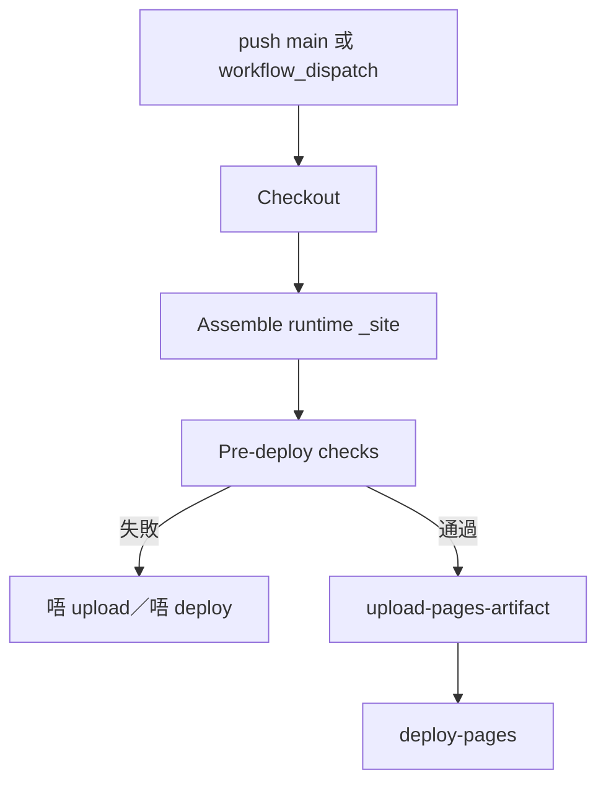

# deploy-pages.kb.md — GitHub Pages 部署（Actions）

> 程式：[`.github/workflows/deploy-pages.yml`](deploy-pages.yml)  
> 慣例：[`docs/agent-knowledge-convention.md`](../../docs/agent-knowledge-convention.md)  
> 設定：Repo **Settings → Pages → Source = GitHub Actions**（一次即可）

## 流程

1. **觸發**：`push` 到 `main`，或手動 `workflow_dispatch`。  
2. **組裝**：把執行期靜態檔複製到 `_site/`（見下表產物範圍）；`js/` 跳過 `*.md`。  
3. **閘門**：pre-deploy checks（必要檔、非空 `APP_VERSION`、引用、禁止路徑／markdown、project `js/` 的 `node --check`）。  
4. **發布**：只有 checks 退出碼 0 才 `upload-pages-artifact` → `deploy-pages`。  
5. **Concurrency**：`group: pages` 且 `cancel-in-progress: true`；較新的 main 推送會取消進行中的部署。

## 架構取捨／決策

| 選項 | 選擇 | 原因 |
| --- | --- | --- |
| Pages 產物範圍 | **只** runtime 靜態前端 | 公開站唔應帶 apps-script／docs／agent notes／archive |
| 納入 | `index.html`、`js/**/*.js`（不含 colocated `*.kb.md`）、`css/`、`vendor/`、引用中嘅 `favicon.ico`／`icon.svg`、`robots.txt` | 瀏覽器實際請求嘅檔 |
| 排除 | `apps-script/`、`docs/`、`archive/`、`diagrams/`、`.github/`、`AGENTS.md`／`README*`／`*.kb.md`、未引用 icon、stamp／gitignore 等 | 題圖由 data repo API（`data-shared-src`／shared-assets）；知識檔唔上線 |
| 連續推 main | `concurrency.cancel-in-progress: true` | 只保留最新 deploy，避免排隊舊產物 |
| 部署前檢查失敗 | **唔** `upload-pages-artifact` | 缺檔、空 `APP_VERSION`、缺引用、洩漏禁止路徑／markdown、project JS 語法錯 → 唔上線 |
| KaTeX vendor `node --check` | **唔當硬閘** | minified vendor 失敗只記 note；project `js/` 語法仍係硬閘 |
| `?v=` cache-bust | **唔要求**等於 `APP_VERSION` | 解析引用時剝掉 query；各檔 query 可不同 |
| Pages Source | GitHub Actions（一次設定） | 取代 legacy `pages-build-deployment` 整庫 checkout |

## 修改史（決策型）

| 方向 | 說明 |
| --- | --- |
| #93 Actions deploy | 用 `deploy-pages.yml` 取代 legacy pages-build-deployment |
| #94 縮小產物 | 只組裝 runtime `_site`，唔發布整份 checkout |
| #95 cancel-in-progress | 連續推 main 只保留最新 Pages deploy |
| #96 pre-deploy checks | 必要檔／版本／引用／洩漏／`node --check`；失敗唔上傳 |

## 待辦

- [x] colocated 本檔並掛入根 `AGENTS.md`（知識庫新鮮度掃描）
- [ ] 改 workflow 產物範圍或閘門規則時，同一 PR 更新本檔

## 文字版 E2E 測試描述

1. 改 `deploy-pages.yml`（或本檔無關嘅 runtime 路徑）後 `push`／`workflow_dispatch`：Actions 應跑「Deploy GitHub Pages」；summary 見 pre-deploy 通過與檔數。  
2. 故意令 `_site` 缺必要檔（或空 `APP_VERSION`、洩漏 `.md`）：job 應 fail，**唔**出現成功 upload／新 Pages 部署。  
3. 短時間連續兩次 push main：較舊嘅 in-flight deploy 應被取消；最終站點對應最新 commit。
