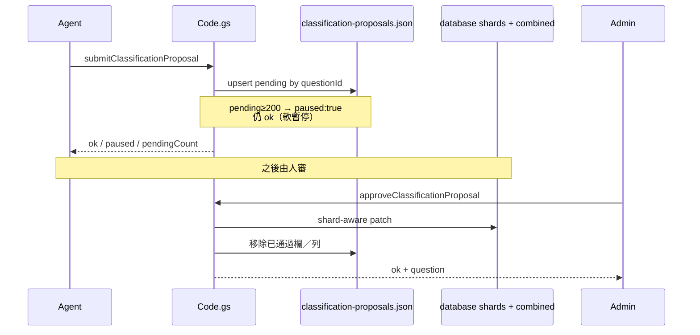

# Code.kb.md — Apps Script 核心行為

> 程式：`apps-script/Code.gs`（單檔；頂部 comment map + `// ===` 區塊）  
> 人類長文：[`README.md`](README.md)

## 流程

### 分類提案

- Blank-only 欄位：題庫已有值 → `blank_only_filled`（`confirmOverwrite` 無效）  
- Always-eligible：已有值或 `reviewedByAI==='Y'` → 需 `confirmOverwrite`  
- 分題提案：平行的 `proposeQuestionParts`／`approveQuestionPartsProposal` 路徑
- **`.37` `flushStagingApprovals`**：mixed parts＋class approve／reject；**validate-all → 每檔一次寫**；cap **50**；整批一個 `takeGitSlot_`＋script lock；`needsConfirm` 唔寫；提案已消失 → `noop`；**marks=0 非 blank**

## 架構取捨／決策

| 選項 | 選擇 | 原因 |
| --- | --- | --- |
| 分類直寫 bank | **禁止**；staging 檔 | 人審閘門；可軟暫停 |
| Soft pause | ≥**200** pending 仍接受 | 不堵 agent；提醒協調者 |
| 大檔讀取 | 短命 read token + 直打 GitHub | 避開 Apps Script 回傳體積／逾時 |
| syncDataDownload（D2） | **shards-only** merge（mock→hkeaa+aristo；否則 hkeaa） | 取消 silent combined fallback |
| 寫入 | 一律 Apps Script + `GITHUB_TOKEN` | 前端永不持寫入 PAT |
| Hub flush 批次（.37） | `flushStagingApprovals` 一鎖驗證後寫 | 避免 N 次 commit／半寫 bank；rate limit 以整批計 |
| 單檔 Code.gs | 維持單檔 + 地圖註解 | 部署簡單；用 banner 導航 |

## Deploy／clasp

- **scriptId（bound 專案）：** `1M1CO1YpfpzSHL7n8g5H-8zpxAP0diXLXkss0Bf6a-5UtsNwOElZTfFx_`  
- **Web app deployment id（／exec）：** `AKfycbyWyuSs8FIpga0fwy8z8A3IGqE3T51FE24Ak3xuLawj5GmD81p3PwvDQjIRzLhIa53y`（改 Code.gs 後需 New version／clasp redeploy）  
- 合併改到 `Code.gs` 後必須 **Manage deployments → Edit → New version**（保留同一 `/exec` URL），或 `clasp push` 後部署新版本。  
- **只改 Script properties** → 立即生效；**改程式碼** → 舊 deployment 仍跑舊碼。  
- 註解-only 變更可不 redeploy（無 runtime 差）。

## 修改史（決策型）

| 方向 | 說明 |
| --- | --- |
| 引入 classification staging | 取代 Python 直寫；archive 舊腳本 |
| Soft pause 200 | backlog 信號而非硬拒 |
| Approve 多分欄／blank-only | 與前端 hub 對齊 |
| Shard-aware bank patch | 與 Phase 3 上傳模型一致 |
| flushStagingApprovals | validate-all；ok 一次寫 bank／proposals；cap 50 |
| D2 shards-only download | `handleGitDownload_` 讀 publisher shards 再 merge；缺 shard 回錯誤 |

## 待辦

- [ ] Code.gs 體積持續增大 — 若拆檔需同時改 clasp／部署慣例  
- [ ] 確認 clasp `.clasp.json` 是否入庫（通常 **不** commit；本機配置）

## 文字版 E2E 測試描述

1. 以 githubSync／admin 呼叫 `submitClassificationProposal` 寫入一題 concepts → staging 有 pending；bank 未變。  
2. 堆到 ≥200 pending 再 submit → `ok:true` 且 `paused:true`。  
3. Admin approve 一欄 → 該欄進正确 shard／combined；staging 該欄消失。  
4. Blank-only 對已填 bank 欄 approve → `blank_only_filled`。  
5. 改 `Code.gs` 後若未 New version，舊客户端行為不變（驗證 redeploy 習慣）。
