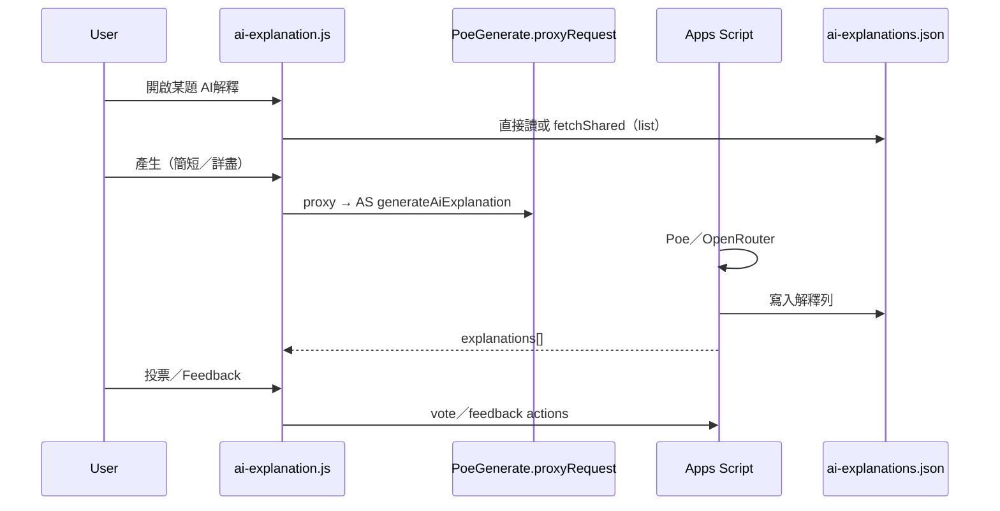

# ai-explanation.kb.md — AI解釋

> 程式：`js/ai-explanation.js`  
> 權限：`accessRights.ai`（與 AI出題相同；`body.poe-ai-allowed`）  
> 儲存：`shared/data/ai-explanations.json`（side-file，非題庫列內）

## 流程

- Admin Feedback 列表在 [`report-issue.kb.md`](report-issue.kb.md) hub 的 AI tab  
- 產生 payload **雙語**：CN+EN 題幹／答案（兼相容舊欄位）

## 架構取捨／決策

| 選項 | 選擇 | 原因 |
| --- | --- | --- |
| 解釋存在題庫 JSON | **否，獨立 side-file** | 題庫列保持穩定；解釋可獨立投票／刪除 |
| 前端直連 Poe | **否** | key 與 allowlist 在 Apps Script；可選使用者自備 browser key |
| 權限 | `ai`（非僅 admin） | 與 AI出題同一閘門 |
| 版本 UI | 可摺疊過去版本 | UX；session 內 `versionsExpanded` |

## 修改史（決策型）

| 方向 | 說明 |
| --- | --- |
| Side-file 落地 | `ai-explanations.json` + Apps Script CRUD／vote／feedback |
| 雙語 reference | 產生時固定帶 CN+EN，減少單語漏答 |
| Hub 合併 Feedback | admin 在回饋 hub 處理，不另開頂欄入口 |
| Backdrop 跟設定（.38） | Feedback 小窗點背景關閉跟 `shouldCloseOnBackdropClick`／`ui.closeOnBackdropClick`；主 AI解釋 modal 本來已 gated |

## 待辦

- [ ] 與 `poe-generate-*.js` 設定／model 下拉的共用邊界（待專檔）  
- [ ] 篩選「有／沒有 AI解釋」兩層邏輯若再改，同步 `filters`／stats docs

## 文字版 E2E 測試描述

1. 無 `ai` 權限：不應見產生按鈕／`poe-ai-allowed` 行為。  
2. 有 `ai`：開一題 → 產生簡短解釋 → 列表出現新版本 → 可投票。  
3. 重新整理後仍可從 side-file 讀回（非僅記憶體）。  
4. Admin：hub → AI Feedback 可關單／刪解釋（刪後題卡同步）。  
5. Poe upstream 失敗時應看到狀態／錯誤類型（非空白失敗）。
6. 使用者設定關閉「點擊背景關閉視窗」時：Feedback 小窗點背景不應關閉；×／取消仍可關。
