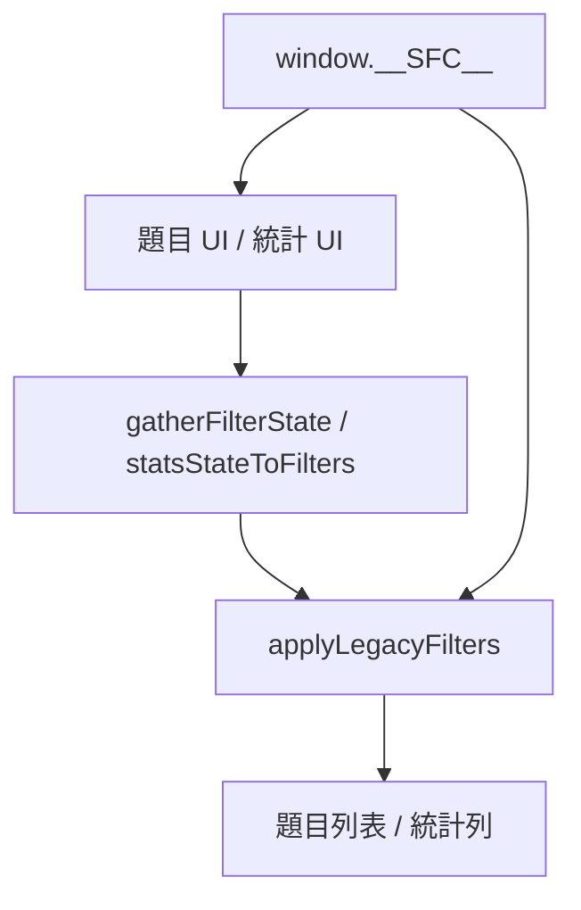

# filter-contract.kb.md — Shared Filter Contract

> 程式：`js/filter-contract.js`（合約＋`applyLegacyFilters`）；薄包裝 `js/storage-filters.js` 的 `applyFilters`  
> 規格：[`FILTER-SPEC.md`](../FILTER-SPEC.md)  
> 地圖：[`docs/filter-system-map.md`](../docs/filter-system-map.md)；題目 UI：[`js/filters.kb.md`](filters.kb.md)

## 流程

- 人繼續用現有篩選控件。代理只呼叫 `window.__SFC__`。
- 空欄（空字串、空 tri map、`active: false`、空條件）＝不限制。
- 畫面初次的 `feature['Out syl']='excluded'` 是有值的預設，不是空合約。
- 篩選 JSON 是 session／query 狀態。不寫 IndexedDB、GitHub sync、題目匯入／匯出。

## 架構取捨／決策

| 選項 | 選擇 | 原因 |
| --- | --- | --- |
| 第二套篩選引擎 | **否** | `applyLegacyFilters` 就是原本 `applyFilters` 的本體 |
| Copy／Paste JSON 按鈕 | **否** | 代理用 `importFilterJSON`／`exportFilterJSON` |
| 題目與統計 | **同一 schema、`surface` 分開** | 統計的 `name` 搜尋不進題目文字；idSet／進階只在題目面 |
| 省略 idSet 的舊呼叫 | **仍繼承 `window.idSetFilter`** | `getQuestions({})` 等既有行為。合約套用本身不繼承 |
| 權限 | **仍先套 mock 權限** | 與 `applyPermissionFilter` 相同 |

## 修改史（決策型）

| 方向 | 說明 |
| --- | --- |
| v1 | 題目＋統計篩選 JSON；`__SFC__` 讀寫；引擎從 `storage-filters.js` 移入本檔 |

## 待辦

- [ ] 統計模組仍未有專屬 `.kb.md`（篩選投影已走本合約）

## 文字版 E2E 測試描述

1. 開頁後 `window.__SFC__.readQuestionsFromUI().triState.feature['Out syl']` 為 `excluded`（使用者設定未改預設時）。  
2. `emptyQuestionsContract()` 套到含 Out syl 的列時，該列仍在（空＝不限制）。  
3. `importFilterJSON` 寫入 `有分題: checked` 後，題目列表只剩有分題；沒有 Copy／Paste 按鈕。  
4. 統計 `searchScope: 'name'` 的合約不依題幹文字縮小 `applyStatsFilterContract` 的結果。  
5. 題目 tab 有 idSet 時，統計計數不跟著縮小（統計投影帶停用的 idSet）。  
6. `node tests/filter-contract.test.js` 通過，並印出 `passed`。
