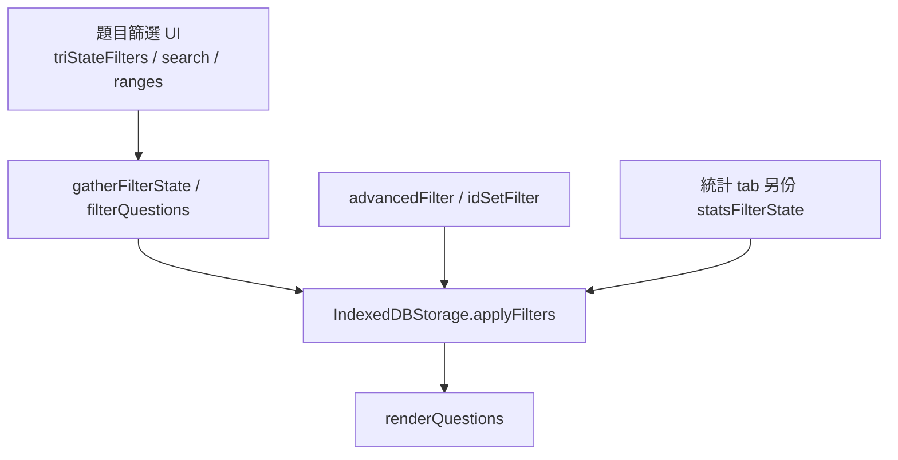

# filters.kb.md — 題目篩選

> 程式：`js/filters.js`（UI／狀態）；常數 `js/constants.js`；套用 `js/filter-contract.js` 的 `applyLegacyFilters`（`js/storage-filters.js` 只留權限＋薄包裝）；特徵邏輯 `js/question-fields.js`；「有未審批事項」→ `js/report-issue.js` staging cache  
> 長文地圖：[`docs/filter-system-map.md`](../docs/filter-system-map.md)  
> 代理合約：[`FILTER-SPEC.md`](../FILTER-SPEC.md)、[`js/filter-contract.kb.md`](filter-contract.kb.md)。人用現有 UI；`window.__SFC__` 讀寫同一套篩選。空欄＝不限制。篩選 JSON 不入庫。

## 流程

- 特徵 checkbox 來自 `FEATURE_ITEMS`  
- Admin 另開「空白／缺漏」來自 `ADMIN_BLANK_FEATURE_ITEMS`（`accessRights.admin`）  
- `partPerformance` UI 標籤為 **考生表現**（keys 仍是 `partPerformance`）

## 架構取捨／決策

| 選項 | 選擇 | 原因 |
| --- | --- | --- |
| 「有分題」放特徵 | **是**（`FEATURE_ITEMS` 含「有分題」） | 常見正向篩選 |
| 「沒有分題」放特徵 | **否** | 特徵列只保留「有分題」；「沒有／尚未輸入」走 `partsStatus` 語意與 admin「尚未輸入分題」 |
| 空白／缺漏放特徵內 | **否** | 獨立 admin dropdown，避免一般使用者誤用資料品質篩選 |
| 「分題表現」命名 | UI → **考生表現**；keys 不變 | PR #76；避免改 storage／進階篩選 field id |
| 「有未審批事項」資料源 | **`ReportIssue.pendingForQuestion`**（staging cache／`partsRows`／`classRows`） | 與題目 tab ✓／✕ 同一真相；唔另造 pending 清單 |
| staging cache 未就緒 | **`filterQuestions` 先 `await ensureStagingCache`**；matcher 未就緒時當無 match | 避免 excluded 在載入前誤成「全部通過」；載入後再評一次 |
| 本機已 approve／reject 未 flush | 已從 `partsRows`／`classRows` 移除 → filter 唔再命中 | 與 chip 隱藏一致（`applyPendingOpsToLoadedRows`） |
| 特徵多選邏輯 | 跨 key **AND** | 同時勾互斥特徵會得到空集（見 filter-system-map） |
| 代理讀寫篩選 | **`window.__SFC__` only** | 不另做 Copy／Paste JSON。空物件／空字串＝不限制；畫面預設 `Out syl: excluded` 是有值，不是空白 |

### 常數對照（`js/constants.js`）

**`FEATURE_ITEMS`：** 有內嵌圖、跨課題、跨章節、**有分題**、已刪除、Out syl  

**`ADMIN_BLANK_FEATURE_ITEMS`：** 尚未輸入分題、未輸入考生表現、**有未審批事項**、題目／答案／評卷報告空白、缺內嵌圖／缺原題圖片／缺答案原圖、課程分類空白、章節空白  

**`PART_PERFORMANCE_ITEMS`：** 優異、優良、良好、令人滿意、尚可、欠佳  

## 修改史（決策型）

| 方向 | 說明 |
| --- | --- |
| 特徵精簡 | 拿掉特徵內的「沒有分題」類項，改靠 partsStatus／admin blank |
| Admin blank 獨立 | 「空白／缺漏」不 merge 進特徵 |
| 考生表現改名 | UI 文案；`partPerformance` key 維持 |
| 有未審批事項（.32） | admin blank 篩 pending 分類／分題 staging；重用 question-tab cache |
| 統計與題目共用引擎 | 同一 `applyFilters` → `applyLegacyFilters`；統計自有 tri-state 副本 |
| Shared Filter Contract v1 | `window.__SFC__` 讀寫題目／統計篩選 JSON；套用仍走原引擎 |

## 待辦

- [ ] `questionFeatureOn` 與 ConditionMatch fallback 雙實作漂移風險（見 architecture-review）  
- [ ] 其餘模組（stats-filters）尚未有專屬 `.kb.md`

## 文字版 E2E 測試描述

1. 非 admin：可見特徵「有分題」等；**不應**見「空白／缺漏」整組（或等價 admin-only 區）。  
2. Admin：開「空白／缺漏」→「尚未輸入分題」／「未輸入考生表現」可篩出對應列。  
3. Admin：勾「有未審批事項」→ 僅見有 pending 分類及／或分題 staging 之題（與卡上「待審批…」一致）；本機 ✓／✕ 後該題應即離開列表（未 flush 亦同）。  
4. 勾「有分題」→ 列表僅 `partsStatus===filled`（或等價 `questionFeatureOn`）之題。  
5. 考生表現區標籤顯示「考生表現」；進階篩選／存檔後 key 仍為 performance 相關欄位。  
6. 統計 tab 跳回題目：tri-state 應帶上對應特徵／表現篩選。  
7. 非 admin：唔見「有未審批事項」（整組「空白／缺漏」隱藏）。
