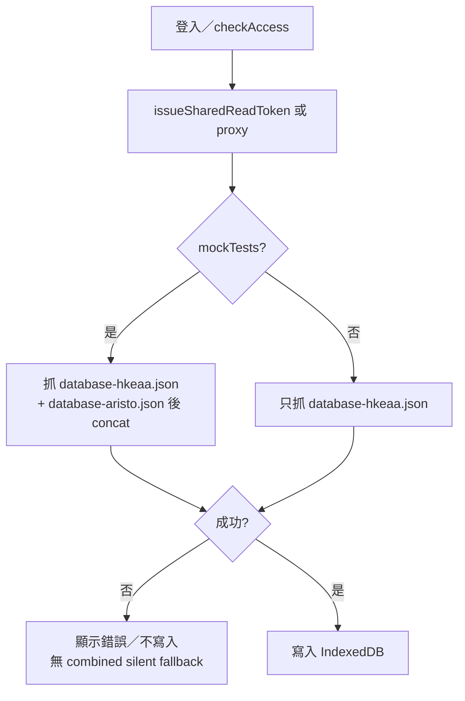
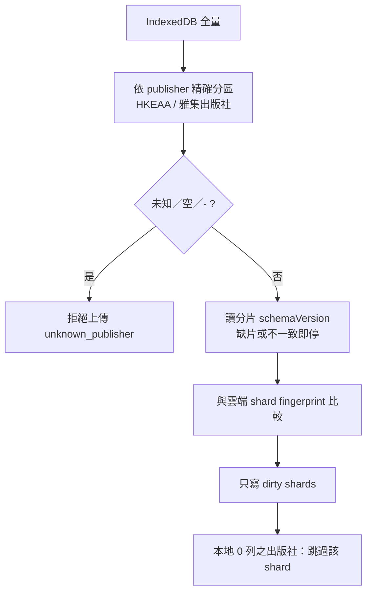

# github-sync.kb.md — 題庫 GitHub 同步

> 程式：`js/github-sync.js`；路徑常數多在 `js/shared-assets.js`／config  
> 部署與角色：[`apps-script/README.md`](../apps-script/README.md)  
> 架構草圖：[`docs/architecture-review-2026-10-09.md`](../docs/architecture-review-2026-10-09.md)

## 流程

### Load（Phase 2 merge-on-load）

- 真相來源：私有 repo **econ-database-data** 的 `shared/data/…`  
- 本機 IndexedDB = 可丟棄快取（見 [`storage-core.kb.md`](storage-core.kb.md)）

### Upload（Phase 3 dirty-shard）

- Schema gate 讀出版社分片。缺分片（`shards_missing`）或兩邊 `schemaVersion` 不一致（`schema_inconsistent`）→ 明確失敗。不讀 combined。
- Client 若本地 `SCHEMA_VERSION` < 雲端分片 `schemaVersion` → 拒傳（`schema_too_new`／stale）  
- 上傳逾時放寬（多 MB JSON；單檔請求）
- **對帳分片**（admin）：`reconcileBankShards`。回傳 HKEAA／雅集題數、`schemaVersion`、檔案 sha、`idDigest`（排序後 id 以換行串接的 SHA-256 hex）、跨片 id 重疊。不讀 combined、不回傳題幹。

## 架構取捨／決策

| 選項 | 選擇 | 原因 |
| --- | --- | --- |
| 單一 `database.json` | **只寫 dirty publisher shards** | 合併檔已停用（D4–D12）；HKEAA／雅集仍分檔 |
| 空本地當空 shard 上傳 | **禁止**（skip／`empty_shard_refused`） | 防誤刪雲端雅集或 HKEAA |
| 寫入 token 放前端 | **否** | 只經 Apps Script；讀可用短命 read token |
| schema gate | client + server 雙查 | 舊頁面不可蓋新 schema |

## 修改史（決策型）

| 方向 | 說明 |
| --- | --- |
| Phase 2 merge-on-load | 分片讀（mock 雙 shard；否則 HKEAA） |
| D2 shards-only download | 取消 silent combined fallback；`downloadQuestionsFromGit`／`syncDataDownload` 走 shards |
| D4–D6／D10–D11 shards-only 讀寫 | schema 改讀分片；上傳與 approve 不再寫 combined |
| 未知 publisher 硬拒 | 避免靜默寫錯分片 |

## 待辦

- [x] D2：Download／`syncDataDownload` 改 shards-only（無 combined silent fallback）  
- [x] D4–D6／D9–D11：schema、dirty upload、approve 都不碰 combined；`reconcileBankShards` 對帳  
- [ ] 上傳進度 UI／可取消

## 合併檔（obsolete）

`shared/data/database.json` 不再是正常讀寫路徑。觀察窗已由使用者要求一次做完而跳過；程式與文件以分片為準。備份後應從私有資料 repo 刪除該檔。在 Apps Script **以本版 redeploy 之前**，線上舊腳本仍可能在上傳／審批時把檔案寫回去。

## 文字版 E2E 測試描述

1. mockTests 使用者載入後應同時有 HKEAA + 雅集題（若雲端雙 shard 存在）。  
2. 無 mockTests：只載入 HKEAA shard（不下載 aristo；不 fallback combined）。  
3. 只改 HKEAA 題後上傳：應更新 `database-hkeaa.json`（若 dirty），**不** 寫 `database.json`，且 **不** 用空檔蓋 `database-aristo.json`。  
4. 故意把某題 `publisher` 改成未知字串 → 上傳應失敗並提示。  
5. 用舊前端（較低 `SCHEMA_VERSION`）對新 bank 上傳 → 應被 schema gate 擋住。  
6. 兩片 `schemaVersion` 不同，或拿掉其中一片 → 上傳／mock 載入應失敗，且不會改去讀 `database.json`。  
7. Admin 按「對帳分片」：狀態列顯示兩邊題數與是否一致；Network 只有 `reconcileBankShards`，沒有 `database.json`。
