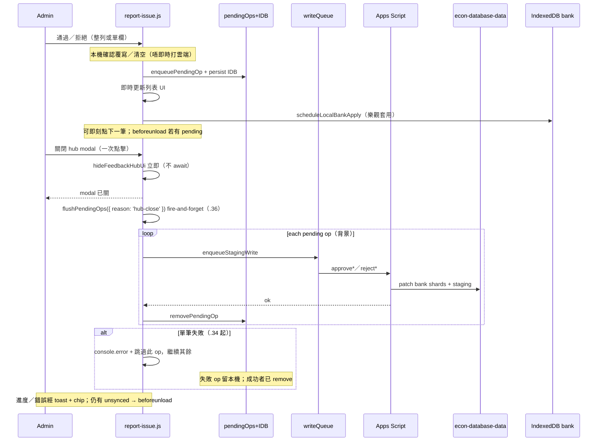

# report-issue.kb.md — 回饋／回報 hub

> 程式：`js/report-issue.js`  
> 相關：[`docs/classification-proposals.md`](../docs/classification-proposals.md)、[`apps-script/Code.kb.md`](../apps-script/Code.kb.md)

## 流程

Admin hub「審批與回報」四個 tab：`issues`（問題回報）｜`ai`（AI解釋 Feedback）｜`parts`（分題審批）｜`classification`（分類審批）。

### 分類／分題審批（approve／reject）— local-first queue



- **批量通過**（`bulkApprove*`）仍即時打雲端；若本機仍有 pending，會提示先關閉同步。
- Soft refresh／關頁：pending 存 `EconFeedbackHubPending`（IndexedDB；失敗時 fallback `localStorage`）。

### 兩套同步邏輯（hub vs 題目 tab）

| 場景 | 行為 |
| --- | --- |
| **Hub「審批與回報」內** | local-first（`.29`）：approve／reject → `pendingOps`；**唔**逐點上雲；**關閉 modal** 立即 hide，背景 `flushPendingOps({ reason: 'hub-close' })`（`.36`）；**唔** await／**唔** disable 關閉；進度／錯誤經 toast+chip；unsynced 仍 `beforeunload` |
| **題目 tab ✓／✕（hub 外）** | 同樣先 `enqueuePendingOp`（樂觀 UI）；之後跟 **`readAutoSync()`**（`econ_git_auto_sync`／header「自動同步」checkbox，同 `github-sync.js`） |
| ↳ 自動同步 **開** | 即刻 `flushPendingOps({ reason: 'auto-sync' })`（經 `enqueueStagingWrite` 防 409）；**唔使開 hub** |
| ↳ 自動同步 **關** | 留本機 queue；header chip「待上傳審批 N」＋「立即上傳」；或再開自動同步後下次外層操作／手動上傳 |
| **兩者** | 有 unsynced pending → `beforeunload`；flush **批次 validate-then-commit**（.37；≤50／批）＋跳過失敗（.34）；失敗／needsConfirm 保留 pending＋`console.error`＋toast＋chip；「檢視佇列」撤銷（.35）；hub 關窗背景 flush（.36） |

### 題目 tab 卡上 ✓／✕（`.30`／`.31`／`.33` preview）

- Admin（`rights.admin`）`ensureStagingCache` 拉 `listClassificationProposals`／`listQuestionPartsProposals`。
- 有 pending → 卡上「待審批分類」／「待審批分題」＋✓／✕；無 pending → UI 不變。
- **`.33` 提案預覽**：黃色 bar 內顯示 proposed 內容（唔使開 hub）  
  - 分類：`stagingClassPreviewHtml` — 每欄 `classFieldLabel` + `formatClassList(proposed)`；若與 `currentValues` 不同則附「現有：…」  
  - 分題：`stagingPartsPreviewHtml` — 每行「分題 {label}｜{marks} 分｜{performance}」（空時回落 `formatPartsPreview`）  
  - CSS：`.question-staging-preview`／`-field`／`-proposed`／`-current`（`report-issue.css`）
- ✓／✕ = one-shot 整單通過／拒絕（重用 hub `approve*Proposal`／`reject*Proposal`）；**唔**做 per-field（卡上仍整單）。
- 外層入口：`handleCardStagingAction`（讀 `isGitAutoSyncOn()` → `readAutoSync`）。
- `ReportIssue.stagingActionsHtml`／`refreshQuestionCardStaging` 畀 `render.js`／`main.js`。
- Admin「空白／缺漏」**有未審批事項**（.32）：`questionFeatureOn` → `pendingForQuestion`；`filterQuestions` 會 `await ensureStagingCache`；本機 approve 後列／chip 一齊消失。

### Soft pause banner

- `classPendingCount >= classPauseThreshold`（預設 **200**）→ 顯示暫停橫幅  
- Intake（`submitClassificationProposal`）仍接受；此為審批 backlog 提醒
- 本機 queue **不**減少其他 admin 所見的雲端 pendingCount，直至 flush

## 架構取捨／決策

| 選項 | 選擇 | 原因 |
| --- | --- | --- |
| Hub 內每點即時上雲 | **否**（local-first） | 點擊要即時；網路／GitHub 寫入慢 |
| Hub 何時 flush | **關閉 hub modal** | session 多筆審批，關窗串列寫入 |
| 題目 tab（hub 外）何時上雲 | **跟「自動同步」**（`readAutoSync`）；關則 queue＋「立即上傳」chip | 唔另造設定；唔強迫開 hub |
| 持久化 pending | **IndexedDB `EconFeedbackHubPending`**（+ localStorage fallback） | soft refresh 唔好無聲丟工 |
| 離開頁警告 | **`beforeunload` 僅在有 unsynced pending** | 瀏覽器多忽略自訂字串，仍要 wire；flush 失敗另用 in-app confirm |
| 多 admin 一致性 | **接受 flush 前 staleness** | 他機會仍見未 flush 嘅 staging；文件化風險 |
| 並行寫 staging／bank | **`enqueueStagingWrite` 串列**（flush 時） | 避免同檔 409 |
| 樂觀 bank IDB | **enqueue 時即 `scheduleLocalBankApply`** | 列表外題庫 UI 即時反映；flush 成功再用 server snap 覆寫 |
| 整 hub `busy` 擋到 IDB | **否**（PR #78 起） | 本機 getAll 慢 |
| 分類欄位 | `CLASS_FIELD_META`：always-eligible vs blank-only | 與 Apps Script／docs 對齊 |
| 通過後清空欄位 | 需 confirm | 避免誤清 bank |
| 題目卡審批 | **✓／✕ one-shot**（admin only） | 睇題時快批；邏輯同 hub queue |
| 待上傳佇列檢視／撤銷（.35） | chip「檢視佇列」／點標籤開 panel；每列「撤銷」 | 上傳前可覆核；`removePendingOp`＋還原 staging＋undo 樂觀 bank |
| flush 遇失敗 | **跳過該筆、繼續其餘**（.34）；取消覆寫 confirm 亦 skip＋continue | 避免首筆（如 marks=0）卡住整批 0／N |
| flush 批次 validate-then-commit（.37） | **`flushStagingApprovals`** 一鎖一驗證；成功項一次寫檔；cap 50；needsConfirm skip 唔彈窗 | 10 審批 ≈ 1–3 commit groups；避免半寫 bank |
| 失敗可觀測性 | 每筆 `console.error('[審批同步失敗]', …)`＋結束摘要 | toast  alone 難排查；DevTools 見 questionId／proposalId／raw |
| 本機改題後仍失敗 | **預期**：flush 重送 staging `proposalId` approve，**不**帶本機編輯；server 比對提案分題合計 vs **雲端 bank** `marks`；`0` ≠ blank（blank 才自動合計） | 須改雲端總分或清空總分後再上傳；見下方「編輯仍失敗」 |

### 編輯題目後同步仍失敗（Q2）

審批 flush 呼叫 `approveQuestionPartsProposal` 時只帶 **staging `proposalId`**，套用的是雲端 staging 提案，不是題目 tab 本機剛改過的題目內容。伺服器 `validateProposalPartsSum_` 把提案分題分數合計與 **雲端題庫** 該題的 `marks` 比對：空白／非數字總分會自動用分題合計；數值 **包括 0** 則必須相符。因此若雲端 `marks` 仍是 `0`、分題合計是 7，本機把題目改正確後再按「立即上傳」仍會失敗——queued op 未改寫，雲端總分亦未變。正確做法：在雲端題庫把該題總分改成與分題一致，或清空總分（留空）後再上傳；toast 在 marks 不符時會附一句提示。


### 待上傳佇列檢視／撤銷（.35）

- Header chip「待上傳審批 N」旁有**檢視佇列**；點標籤亦可開 panel。
- Panel 列出每筆 `pendingOps`：`questionId`、種類（分題／分類）、動作（通過／拒絕／保留原值）、短預覽（`bankSnap`／`values`／`proposalSnap`）。
- **撤銷**：`removePendingOp(localId)`；若有 `proposalSnap` 則插回 `partsRows`／`classRows`，否則 `ensureStagingCache(true)` 由雲端重拉（提案尚未 flush 仍在 staging）；approve 若有 `undoBankSnap` 則還原本機樂觀題庫套用。
- 撤銷後刷新 hub 列表（若開著）、題目卡 staging、chip；flush 中不可撤銷。
- **Backdrop（.38）**：點 panel 背景關閉受 `shouldCloseOnBackdropClick()` 控制（使用者設定「點擊背景關閉視窗」）；×／關閉／Esc 不受影響。


## .37 批次 validate-then-commit（設計筆記／實作）

### 思考過的邊界（實作前）

| 議題 | 決定 |
| --- | --- |
| **混合 parts + class + reject** | 同一 `flushStagingApprovals`：lazy 載入所需 store；validate 全部 → 只 apply `okToApply` → 最多寫 bank 一次 + parts proposals 一次 + class proposals 一次 |
| **併發第二次 flush** | 客戶端 `hubState.flushing` 擋；伺服器 `LockService` + `takeGitSlot_`（整批一個 slot，非每筆） |
| **blank_only_filled / proposalRemaining** | 無可寫欄 → staging trim；`status:ok` + `blankOnlyFilled`；客戶端仍從 queue 移除（同 .34 行為） |
| **needsConfirm** | **唔**喺 batch／hub-close 彈 confirm；skip + 留 pending + toast／`console.error`；enqueue 時已 confirm 則帶 `confirmOverwrite:true` |
| **單筆 approve 路徑** | 保留既有 `approve*`／`reject*`（hub 一鍵仍入 queue）；flush 走 batch（含 batch-of-1）；舊 deployment 未知 action → sequential fallback |
| **Apps Script 上限** | 伺服器 cap **50**（`batch_too_large`）；客戶端 chunk 其餘；一 batch ≈ 一個 git slot／lock 週期 |
| **marks=0** | **唔**當 blank；`validateProposalPartsSum_`：只有 null／空字串才 auto-sum；0 必須與分題合計相符 |
| **Idempotency** | 提案已不在 staging → `status:noop` → 客戶端當成功移除 queue |
| **Hub close** | 維持 .36 fire-and-forget；batch 唔 re-block close |
| **佇列／撤銷** | 不變；flush 中仍不可撤銷 |

### 流程（.37）

```mermaid
sequenceDiagram
  participant Hub as report-issue.js
  participant AS as flushStagingApprovals
  participant GH as GitHub files

  Hub->>Hub: hubState.flushing gate
  loop chunks of ≤50
    Hub->>AS: ops[] (mixed kinds)
    Note over AS: load stores once; validate all
    AS->>AS: partition ok / failed / needsConfirm / noop
    AS->>AS: apply okToApply in memory
    alt any ok bank/proposal dirty
      AS->>GH: bank (1 write group) + proposals files
    end
    AS-->>Hub: per-item results
    Hub->>Hub: remove ok+noop; leave failed/needsConfirm
  end
```

- **Commit 行為：** 10 筆成功 approve ≈ **1–3 Git write groups**（bank dual-write 可能 1–3 檔 + 最多 2 個 proposals 檔），**唔**係每題一 commit。
- **失敗：** 逐項 `console.error` + 摘要；失敗／needsConfirm 留 `pendingOps`；chip「立即上傳」可重試。

## 修改史（決策型）

| 何時／PR | 方向改變 |
| --- | --- |
| 分類 staging 落地 | 分類不再直寫 bank；hub 加「分類審批」 |
| 多分欄 approve | 每欄「通過此欄／保留原值」；partial 留下剩餘欄 |
| PR #78（`.28`） | **Approve unlock**：staging 成功即解鎖；IDB apply 背景化；寫入佇列＋per-proposal in-flight |
| `.29` local-first | **Approve／reject 先入本機 queue**；關 hub 先 flush；IDB 持久化；`beforeunload`；多 admin staleness 接受 |
| `.30` 題目卡 ✓／✕ | 題目 tab 卡對 pending 分類／分題 one-shot 入同一 pendingOps；無 pending 唔顯示 |
| `.31` hub vs 外層同步 | Hub 維持關窗 flush；題目 tab 跟 `readAutoSync` 即時 flush 或留 queue＋chip |
| `.32` 有未審批事項 filter | admin blank 重用 staging cache／`pendingForQuestion`；唔另造 pending 源 |
| `.33` 卡上提案預覽 | 黃色 bar 顯示 proposedValues／questionParts（`formatClassList`／`formatPartsPreview`）；✓／✕ 不變 |
| `.34` flush 跳過失敗 | 單筆失敗／取消覆寫 → `console.error`＋留 pending＋**繼續**其餘；部分完成 toast；marks 不符附總分=0 提示；說明本機編輯≠重寫 approve op |
| `.35` 待上傳佇列撤銷 | chip「檢視佇列」panel；`proposalSnap`／`undoBankSnap`；單項撤銷還原 staging＋本機 bank |
| `.36` hub-close 背景 flush | 關窗立即 hide；`flushPendingOps({reason:'hub-close'})` fire-and-forget |
| `.37` 批次 validate-then-commit | `flushStagingApprovals`：validate-all → 每檔一次 Git；mixed parts/class/reject；cap 50；noop idempotent；needsConfirm skip |
| `.38` 待上傳佇列 backdrop | 「待上傳審批佇列」panel 點背景關閉跟 `shouldCloseOnBackdropClick`／`ui.closeOnBackdropClick`（與 hub／其他 modal 一致；Esc／×／關閉仍可用） |

## 待辦

- [x] 待上傳佇列檢視／撤銷（.35；chip panel＋單項撤銷＋undo bank／還原 staging）
- [x] 題目卡 pending 顯示提案內容（.33；分類欄位 diff + 分題 parts preview）
- [x] 大批量 flush validate-then-commit（.37；cap 50＋per-item results）
- [ ] 大批量分類通過時的進度／取消 UX（待核實需求）
- [ ] issues／AI tab 是否也需要 per-item in-flight／local queue（目前多用 `hubState.busy` 即時雲端）
- [x] flush 跳過失敗繼續其餘（.34；取消覆寫亦 skip＋continue；未做「取消其餘」按鈕）
- [ ] flush 中「取消其餘」按鈕（可選）
- [x] 題目列表「只睇待審批」篩選 → admin「空白／缺漏」**有未審批事項**（.32；`questionFeatureOn`＋`pendingForQuestion`）

## 文字版 E2E 測試描述

1. 以 admin 登入 → 開「回饋／回報」→「分類審批」。  
2. 對一筆 pending：點「通過」；橫幅應似「已通過（本機）…待同步」；**唔應**等網路即可對另一筆再點通過。  
3. Soft refresh（F5）後再開 hub：先前本機通過嘅提案唔應再出現喺列表（pending 由 IDB 還原並套用）；橫幅提示待同步。  
4. 關閉 hub：應見「正在同步至雲端（i／n）」→ 成功訊息；再開 hub／另一瀏覽器應反映雲端已審批。  
5. 模擬 flush 失敗（斷網後關閉）：應錯誤橫幅／toast、唔宣稱成功；confirm 後可關閉；pending 仍在；DevTools 見 `[審批同步失敗]`；恢復網路再關可重試。  
6. 有 pending 時重新整理／關 tab：應觸發瀏覽器 leave warning（`beforeunload`）。  
7. 單欄：blank-only 且題庫已有值 →「通過此欄」略過／禁用；always-eligible 已有值 → 覆寫確認（喺 enqueue 前）。  
8. pending ≥200 時應見暫停橫幅；另用 agent 再 submit 一題仍應成功（`paused:true`）。  
9. 分題審批：本機已有分題 → 覆寫 confirm 後入 queue；拒絕只喺 flush 後刪 staging、不改 bank。  
10. 有本機 pending 時按「通過全部」批量：應提示先關閉同步，唔直接批量。

11. 題目 tab（admin）：有 pending 見「待審批…」＋提案內容預覽＋✓／✕；分類見欄位／提案（現有若不同）；分題見 `formatPartsPreview`；非 admin／無 pending → 唔見。  
12. **自動同步開**：卡上 ✓ → toast 上傳中 → 成功後 chip 清空；**唔使**開「審批與回報」。  
13. **自動同步關**：卡上 ✓ → 入本機佇列、chip「待上傳審批」；按「立即上傳」或稍後再開自動同步；關頁有 beforeunload。  
14. Hub 內通過多筆 → **唔**因自動同步而逐點上雲；只喺關 hub 時 flush。  
15. 同一題分類＋分題：兩行各自 ✓／✕。  
16. 斷網＋外層自動同步開：flush 失敗 → 錯誤 toast、pending／chip 保留；DevTools `console.error('[審批同步失敗]')`；恢復後「立即上傳」成功。  
18. **跳過失敗繼續**：queue 多筆，首筆故意失敗（例如分題合計 ≠ 雲端 marks=0）→ toast「同步部分完成（已完成 X／Y）」或「失敗 N 項」；其餘成功者已上雲並從 pending 移除；失敗者仍在 chip；`console.error` 有每筆詳情＋摘要。  
19. **編輯本機題目後重試**：只改本機 marks／分題、唔改雲端 bank → 同一 proposal 仍失敗（見「編輯題目後同步仍失敗」）；改雲端總分或清空總分後再上傳才成功；toast 可含總分=0 提示。  
20. flush 覆寫 confirm：**取消** → 該筆 skip＋continue（唔中斷整批）；確定覆寫 → 該筆帶 `confirmOverwrite` 重試。  
17. Admin「空白／缺漏」→「有未審批事項」：列表＝有卡上待審批 chip 之題；✓ 後即離開（未 flush 亦同）；非 admin 唔見此項。

21. **檢視佇列**：本機通過／拒絕數筆後，chip 見「待上傳審批 N」→ 按「檢視佇列」（或點標籤）→ panel 列出 questionId／分題或分類／通過或拒絕／預覽。  
22. **撤銷**：對一筆按「撤銷」→ 該筆離開 pending／chip 減 1；hub（若開）與題目卡再出現該待審批；若曾本機套用分題／分類，題庫 UI 應回退；其餘佇列項不變。  
23. flush 進行中：撤銷按鈕應禁用；上傳完畢且佇列空 → panel 顯示沒有待上傳項目。

24. **批次 flush**：本機通過 10 筆（可混分題＋分類＋拒絕）→ 關 hub／立即上傳 → DevTools 見 `[審批同步] batch summary`（`gitWriteGroups` 約 1–3，唔係 10+）；成功者離開 pending。
25. **部分失敗**：故意一筆 marks 不符 → 其餘成功上雲；失敗者留 chip；`console.error` 有詳情。
26. **needsConfirm 背景**：flush 遇需覆寫且無 `confirmOverwrite` → **唔**彈窗；該筆留 pending；其餘繼續。
27. **Idempotent**：同一提案已審走後再 flush → `noop`、queue 清走、唔當整批失敗。
28. **>50**：queue 60 筆 → 兩批（50+10）依次；唔回 `batch_too_large`（客戶端已 chunk）。
