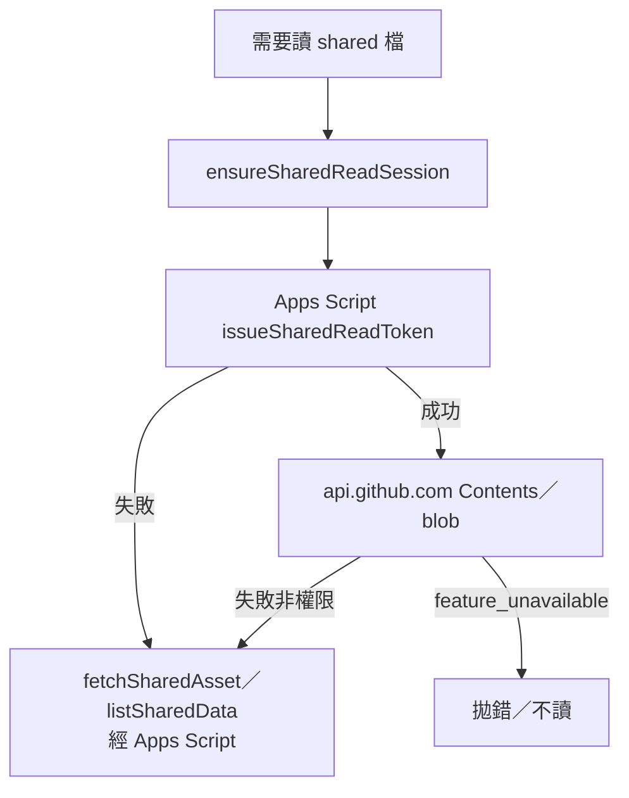
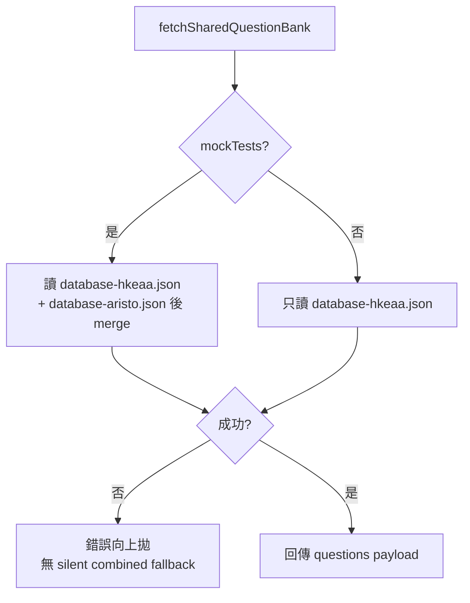

# shared-assets.kb.md — 共用資產讀取（read-path）

> 程式：`js/shared-assets.js`  
> 上傳／dirty-shard：[`js/github-sync.kb.md`](github-sync.kb.md)（本模組只讀；寫入仍經 Apps Script）  
> 路徑規則對齊：`apps-script/Code.gs` 的 `githubSharedRelOk_`  
> 部署：[`apps-script/README.md`](../apps-script/README.md)

## 流程

### 短命 read token → 直接 GitHub（失敗才 proxy）

- 寫入 token（`GITHUB_TOKEN`）**永不**進瀏覽器；本模組 **read-path only**。
- Session 只在記憶體（`sharedReadSession`）；`pagehide` 清掉。

### 題庫 load（D2 shards-only）

- `downloadQuestionsFromGit`／`syncDataDownload` 偏好呼叫本函式（見 [`github-sync.kb.md`](github-sync.kb.md)）。
- `data/database.json` 在讀取閘門直接拒絕。沒有 combined diagnostic helper。
- mock 同時讀到兩片時，`schemaVersion` 必須相同，否則 `schema_inconsistent`。

### 路徑閘門

- Allowlist：`SHARED_ASSET_ROOTS`（`data`／`diagrams`／`originals`／`papers`／`build`）+ 副檔名表 → `sharedAssetPathOk`。
- Mock-only（無 `mockTests` 拒讀）：`sharedMockOnlyPath` — 含 `data/database-aristo.json`、`diagrams/**`、`papers/mock-tests/**`、`build/**`、部分 `originals/`。
- `data/data-checks.json` 另需 `canReadDataChecks`。

### 其他讀取面

- `hydrateSharedImages`：`img[data-shared-src]` → `sharedAssetObjectUrl`（`sharedBlobCache`）。
- `listSharedData`：直連 tree／contents；失敗 fallback Apps Script `listSharedData`。
- Publisher helpers（`partitionQuestionsByPublisher`、fingerprint）供 **upload Phase 3** 用；實際寫檔仍走 github-sync → Apps Script。

## 架構取捨／決策

| 選項 | 選擇 | 原因 |
| --- | --- | --- |
| 大檔經 Apps Script echo | **否**（優先短命 read token 直連 GitHub） | 避開 googleusercontent 體積／逾時 |
| Bank load 失敗時 silent `database.json` | **否** | 失敗要可見；合併檔已停用 |
| 對帳 | `reconcileBankShards`（Apps Script，見 github-sync） | 不靠 combined 對題數／schema／id |
| 未知 publisher 分片 | `unknown` 桶；上傳硬拒 | 防靜默寫錯 shard（見 github-sync） |
| 寫 token 放前端 | **否** | 突變只經 Apps Script |

## 修改史（決策型）

| 方向 | 說明 |
| --- | --- |
| 短命 read token | `issueSharedReadToken` → Contents／blob；失敗才 `fetchSharedAsset` |
| Phase 2 merge-on-load | mock 雙 shard；否則 HKEAA |
| D2 shards-only download（PR #89） | 取消 silent combined fallback |
| D4／D10 | 拿掉 combined 讀取與 diagnostic helper；兩片 schema 不一致即失敗 |
| Phase 3 helpers colocated | partition／fingerprint 在此；寫入流程在 github-sync |

## 待辦

- [x] D10：combined 不再是讀取路徑；diagnostic helper 已移除
- [ ] 上傳進度 UI（屬 github-sync；本檔不負責）

## 文字版 E2E 測試描述

1. 登入後首次讀圖／題庫：應先拿到短命 token，Network 可見直連 `api.github.com`（非整包經 Apps Script）。  
2. mockTests 使用者：`fetchSharedQuestionBank` 應同時有 HKEAA + 雅集題。  
3. 無 mockTests：只載入 HKEAA；請求 `database-aristo.json`／`diagrams/…` 應被拒。  
4. 故意令某 shard 404／壞 JSON：load 應失敗並顯示錯誤，**不**默默改讀 `database.json`。  
5. 請求 `data/database.json` 應被拒。一般 load 不應出現該路徑。