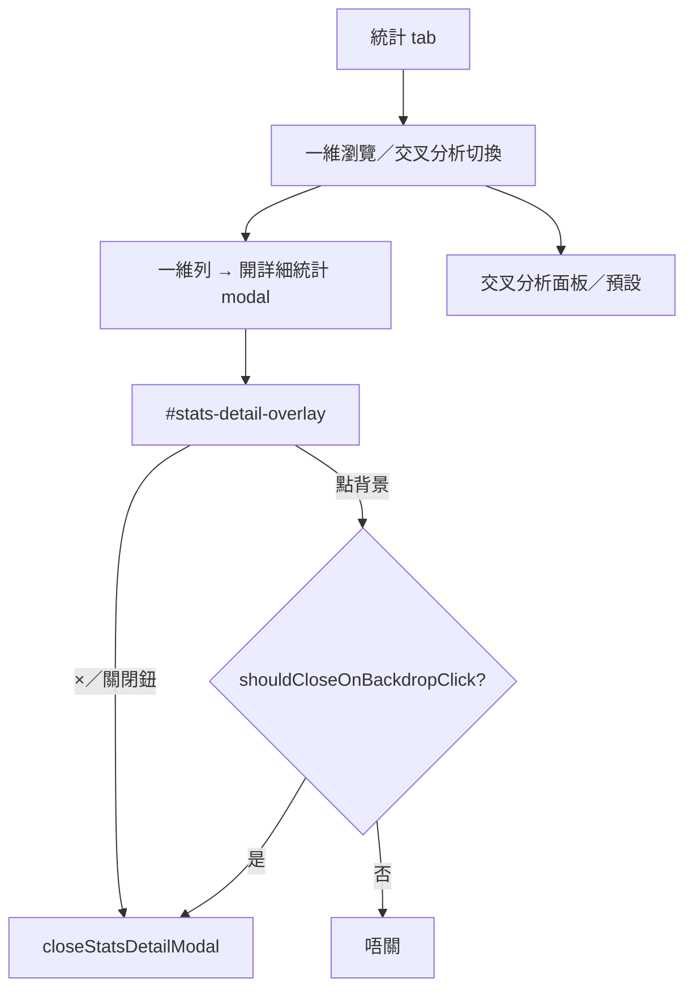

# stats-explore.kb.md — 統計詳情／交叉分析

> 程式：`js/stats-explore.js`  
> 樣式：`css/stats-explore.css`（經 `main.css` 載入）  
> 維度清單／篩選：`STAT_TABS`／`STAT_DIMENSION_GROUPS`（`js/stats-filters.js`）  
> Backdrop 閘門：`shouldCloseOnBackdropClick()`（`js/utils.js` → `ui.closeOnBackdropClick`）

## 流程

- 統計 tab chrome：dimension switcher、詳細統計 modal、交叉分析。
- `ensureDetailOverlay`：點 `#stats-detail-overlay` **背景**時，只有 `shouldCloseOnBackdropClick()` 為真先 `closeStatsDetailModal()`。
- ×（`.stats-detail-close`）與「關閉」（`#stats-detail-close-btn`）**唔**經此閘，一律關閉。

## 架構取捨／決策

| 選項 | 選擇 | 原因 |
| --- | --- | --- |
| 點背景關閉 | 跟 `shouldCloseOnBackdropClick()`（讀 `ui.closeOnBackdropClick`） | 與其他 modal／待上傳佇列 panel 一致；**唔**硬編碼永遠關 |
| ×／關閉鈕 | 永遠可關 | 設定只閘 backdrop，唔鎖明確關閉 |

## 修改史（決策型）

| 方向 | 說明 |
| --- | --- |
| `.38` backdrop 閘門 | PR #87：`ensureDetailOverlay` 點背景先經 `shouldCloseOnBackdropClick()` |

## 待辦

- [ ] Esc 關閉詳細統計 modal（若未綁）是否與其他 overlay 一齊收進 `main.js` hotkey
- [ ] 交叉分析大表效能（大量維度組合時）

## 文字版 E2E 測試描述

1. 開統計 tab → 一維列開「詳細統計」modal。  
2. 用戶設定關「點擊背景關閉」→ 點 overlay 背景 **唔關**；×／關閉鈕仍可關。  
3. 再開「點擊背景關閉」→ 點背景會關。  
4. ×／Esc／關閉鈕在兩種設定下仍可用（backdrop 閘門唔影響明確關閉）。
