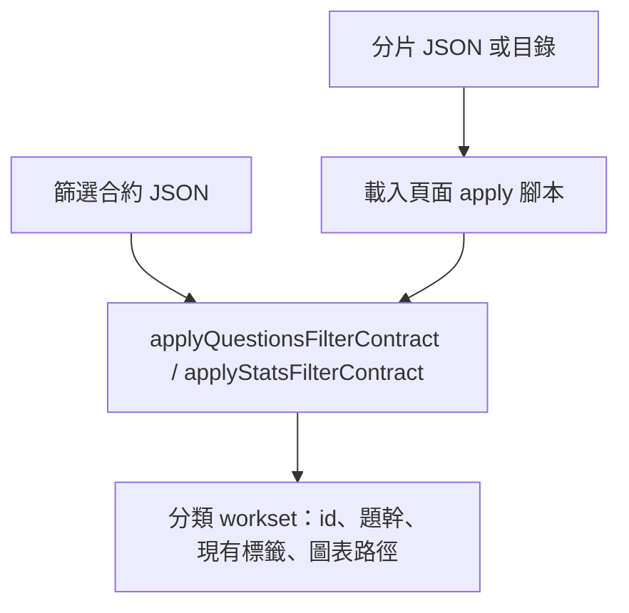

# sfc-apply.kb.md — 無頭 Shared Filter Contract

> 程式：[`tools/sfc-apply.js`](sfc-apply.js)  
> 引擎：[`js/filter-contract.js`](../js/filter-contract.js) 的 `applyQuestionsFilterContract`／`applyStatsFilterContract`  
> 規格：[`FILTER-SPEC.md`](../FILTER-SPEC.md) 第 10 節  
> 瀏覽器契約：[`js/filter-contract.kb.md`](../js/filter-contract.kb.md)

## 流程

1. `node tools/sfc-apply.js --contract contract.json --shards shard.json`（目錄、stdin、`--out` 見規格）。  
2. 程序用 `vm` 載入 `constants.js`、`storage-core.js`、`filter-contract.js`、`storage-filters.js`、`question-fields.js`、`condition-match.js`、`ai-explanation.js`。  
3. 呼叫與 `window.__SFC__` 相同的 apply。預設 `mockTests` 與 `admin` 為開。  
4. 命中列投影成 workset。不寫分片，不送 `submitClassificationProposal`。

## 架構取捨／決策

| 選項 | 選擇 | 原因 |
| --- | --- | --- |
| 第二套篩選引擎 | **否** | CLI 只載入瀏覽器腳本並呼叫 apply |
| 改寫成 bundler／CommonJS 雙包 | **否** | 頁面仍是經典 script；搬動載入方式容易動到 Pages |
| 無頭預設權限 | **mockTests＋admin 開** | 呼叫端已把分片放上命令列。頁面 `emptyAccessRights()` 是登入前不顯示 mock |
| 對齊未授權頁面 | `--no-mock-tests`／`--no-admin` | 同一道 `applyPermissionFilter`／adminBlank 閘 |
| Workset 欄位 | 身份、題幹、分類標籤、圖／表路徑 | 給分類專員的最小列。答案與評卷報告不帶 |
| `inlineDiagramPaths` | 與 `render.js` 的 `diagramSrcs` 相同 | 逗號分隔；去掉 `..` 與帶 scheme 的 URL |
| 「有未審批事項」 | **無 staging cache 時不當命中** | 與 `questionHasPendingStaging` 在 cache 未就緒時相同 |
| 分類寫入 | **不在此工具** | 仍只走 Apps Script `submitClassificationProposal` |
| Copy／Paste JSON | **沒有** | 與 FILTER-SPEC 相同 |

## 修改史（決策型）

| 方向 | 說明 |
| --- | --- |
| 無頭 apply | 補上瀏覽器以外的套用路徑，讓代理用合約 JSON 從分片得到 workset，而不把整庫放進上下文 |

## 待辦

- [ ] 「有未審批事項」若要在無頭環境命中，要另載 staging cache；目前故意不做

## 文字版 E2E 測試描述

1. `node tests/filter-contract.test.js` 與 `node tests/filter-contract-cli.test.js` 都印出 `passed`、`failed: 0`。  
2. 同一份合約：CLI workset 的 id 順序等於瀏覽器 `applyQuestionsFilterContract`／`applyStatsFilterContract`。  
3. 空合約不會因為畫面預設而排除 Out syl。統計 `searchScope: "name"` 不依題幹縮小結果。  
4. `--no-mock-tests` 拿掉雅集與 `MT…` id。`--no-admin` 時「題目空白」不再生效。  
5. workset 含題幹、concepts／stemPatterns、`inlineDiagramPaths`，不含答案與評卷報告。沒有 Copy／Paste JSON。
